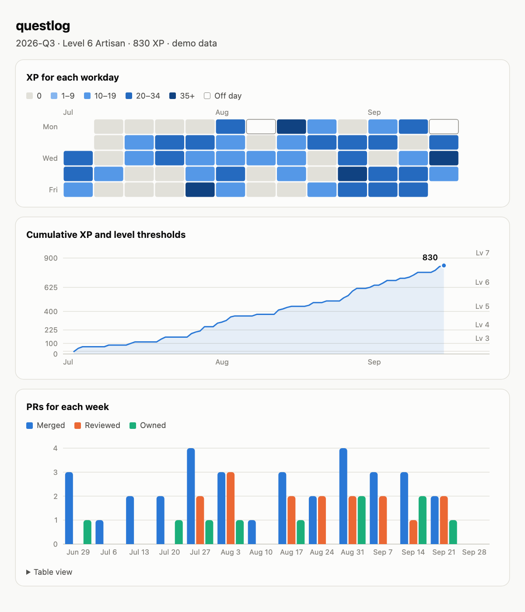

# questlog

questlog is a Claude Code skill that scores your engineering work like a game. It reads your merged and reviewed PRs from GitHub and adds the cards and checks that you log by hand. The game pays more for small, tested PRs and careful reviews than for a high PR count. It also pays you to own each PR before it merges.

<picture>
  <source media="(prefers-color-scheme: dark)" srcset="docs/shots/chart-dark.png">
  
</picture>

The chart comes from `python3 questlog.py chart --demo`. The season in the chart is made up.

```
LEVEL UP: level 1 -> 4, Journeyman
UNLOCKED: Clean Slicer
QUESTLOG 2026-Q4 | day 14 of 92
Level 4 Journeyman | 350 XP | 50 XP to level 5
Workday streak: 6 (best this season: 6)
XP per week: ▃█▅
Last 10 workdays: □■■□■■■■■■
         season                            this week
Merged   12 (10 clean, 6 tested, owned 2)  4 (4 clean, 1 tested, owned 1)
Reviews  9                                 3
Cards    6                                 1
Checks   4                                 1
Areas    20                                8
Achievements
[x] Clean Slicer         10/10
[ ] Test Pilot           6/10
[ ] Second Pair of Eyes  9/20
[ ] Scholar              6/15
[ ] Deep Diver           3/5
[ ] Cartographer         20/25
[ ] Iron Streak          6/10
[ ] Owner                2/10
Today's quests
1. Own it before merge: acme/api#131 Paginate the audit log
2. Review acme/web#123 "Fix login redirect" (PR is 3 days old)
3. Ship one clean slice
4. Write one learning card
```

The names in this sample are made up. The LEVEL UP and UNLOCKED lines print once, on the first run that earns them. The first sparkline row shows XP for each week of the season. The second row shows the last 10 workdays (■ active, □ empty).

## Requirements

- Claude Code.
- `gh`, the GitHub CLI, logged in.
- `python3` 3.9 or newer. The script uses only the standard library.
- A web browser, to look at the chart. Everything else works without one.

## Install

questlog reads only the GitHub account that `gh` is logged in to on the machine where it runs. On the work machine, that is the work account.

```sh
git clone https://github.com/m0n01d/questlog ~/code/questlog
mkdir -p ~/.claude/skills
ln -s ~/code/questlog ~/.claude/skills/questlog
gh auth status
python3 ~/code/questlog/questlog.py selftest
```

1. Run `gh auth status`. Make sure that it shows the account that you want to score.
2. Run the self-test. It prints `ok`.
3. Start Claude Code and run `/questlog`.

## Use

```
/questlog                         show level, streak, counts, achievements and quests
/questlog slice <task>            plan a stack of small PRs for a task
/questlog review <pr>             answer questions about a PR, then read the findings
/questlog own <pr>                the same as review, for your own PR
/questlog card <text>             log one thing that you learned
/questlog off <date>              mark a day off
/questlog recap [days]            write a brag-doc recap (default 7 days)
/questlog chart [--demo]          draw the season as a chart page
/questlog campaign start <epic>   plan the chapters of a Jira epic (session zero)
/questlog campaign                open the day with the story so far and a goal
```

- `<pr>` is `owner/repo#n`, a PR URL, or a number in the current repo.
- `slice` refuses to split a change only to raise the PR count.
- `review` and `own` are one command. Claude compares the PR author with the account that `gh` is logged in to. Then it picks the questions.
- For a PR by someone else, `review` asks three questions before it shows any finding. It logs a check from your answers, then asks for one card.
- `recap` marks each owned PR.
- Claude never posts, pushes, merges or opens a PR without your yes.

The script also runs alone: `python3 ~/.claude/skills/questlog/questlog.py status`. The `dir` command prints the data folder.

## Own your PR

AI-written code can look right and hide faults. If you merge code that you cannot explain, you cannot defend it in review. questlog quizzes you on your own PR before another person reads it. If the PR author is the account that `gh` is logged in to, the PR is yours.

1. Open the PR as a draft. Run `gh pr create --draft`.
2. Run `/questlog own <pr>`.
3. Wait for the map and the questions. Claude writes the expected answers to `rubric.md` in the data folder before it asks. It grades only against that file.
4. Answer each question from the code, not from memory of the task.
5. Read the grades. Each grade has a file:line as evidence.
6. Read the checklist findings. Fix each blocker.
7. If you missed a question, reread the code and retake it.
8. When Claude says "owned", run the tests and the changed path yourself.
9. Run `gh pr ready` to take the PR out of draft. Claude runs it only after your yes.
10. Merge the PR. After the merge, the Owner bonus pays.

Claude asks one question for each file that has logic. It asks at least 3 questions and at most 8. If the PR has more than 8 logic files, Claude calls it too big to own in one pass. Then it suggests `slice`, or a quiz in rounds of 8 files.

Each question is one of five types:

- Why does this line or branch exist?
- What happens on an edge input?
- If line X is deleted, which test fails?
- Does this code duplicate a helper that already exists?
- What changed here that the task did not ask for?

After the grades, Claude runs an AI-code checklist on the whole diff. It looks for these faults:

- an invented or misused API
- logic that fails on an edge case
- a test that restates the code or mocks away the behavior under test
- a deleted or weakened test or assertion
- a swallowed error or a broad catch
- a change that the task did not ask for
- a duplicated helper
- dead code
- a hardcoded value or a secret
- input that crosses a trust boundary without a check

If every answer is right and the checklist finds no blocker, the PR is owned. In any other case, it is not owned. Claude logs the result with `log check --own`. The status shows an `owned` count in the Merged row. It also lists your two oldest open PRs without a passing own check as quests.

## How scoring works

The script scores your work again on each run. The constants live at the top of `questlog.py`. If you change one, the whole season scores again.

| Event | XP | Constant |
|---|---|---|
| Merged PR | 10 | `XP_MERGED` |
| Clean slice: 10 to 400 changed lines | +5 | `XP_CLEAN`, `CLEAN_MIN`, `CLEAN_MAX` |
| Tested: the PR changes a test file | +5 | `XP_TESTED`, `TEST_RE` |
| Owned: the merged PR has an own check with a full score | +10 | `XP_OWNED` |
| Review of a PR by someone else | 10 | `XP_REVIEWED` |
| Learning card | 3 | `XP_CARD` |
| Chapter closed in a campaign: each issue is done, and one of your merged PRs links to it | 25 | `XP_CHAPTER` |
| Check: each point of the score | 2 | `XP_CHECK_POINT` |
| Off day | 0 | none |

Lockfiles, generated files, snapshots, `dist` and `.min.js` files do not count as changed lines (`SKIP_RE`). If a PR has more than 100 files, the script uses the PR totals (`MAX_FILES`).

The owned bonus matches the PR by `owner/repo#n`, and it ignores case. A PR URL works as input. The script stores `owner/repo#n`.

Level is 1 + floor(sqrt(XP / 25)) (`XP_PER_STEP`). The titles are Apprentice (level 1), Journeyman (3), Artisan (5), Expert (7), Master (9) and Legend (11) (`TITLES`).

A season is a calendar quarter. XP, level, streak and achievements start again each season. The log file keeps the old entries.

The streak counts workdays back from today. Weekends and off days neither count nor break it. An empty today does not break it. The status also shows the best streak of the season.

| Achievement | Goal |
|---|---|
| Clean Slicer | 10 clean slices |
| Test Pilot | 10 tested PRs |
| Second Pair of Eyes | 20 reviews |
| Scholar | 15 cards |
| Deep Diver | 5 perfect checks (a full score) |
| Cartographer | 25 areas |
| Iron Streak | a best streak of 10 workdays |
| Owner | 10 owned merged PRs |

An area is a `repo:dir1/dir2` value from the paths that your merged PRs touch. Change the goals in `ACHIEVEMENTS`.

A game can be gamed. questlog counts only merged PRs, and it weights tests, reviews and checks. The coach refuses to pad the count.

## Chart

The `chart` command writes `chart.html` to the data folder and opens it in your browser. The page has three charts:

- A heatmap of XP for each workday, like the GitHub contribution graph.
- A line of cumulative XP, with a line at each level threshold.
- Weekly bars of merged, reviewed and owned PRs.

The page is one file. It has inline SVG and CSS, with no script and no network request. It shows dates and numbers only. It never shows a repo name or a PR title. It follows the light or dark mode of your browser.

On a machine with no display, add `--no-open`. Then open the file on another machine. Add `--demo` to draw a made-up season. The demo reads no GitHub data and no log.

## Campaign mode

Campaign mode turns a Jira epic into a campaign. The `campaign` command reads the epic and its child issues from Jira. It links your merged PRs to the issues by the Jira key in the PR title or branch. Then it prints one report. In Claude Code, Claude plays the game master (the narrator and referee) and keeps a journal. The design is in [docs/CAMPAIGN.md](docs/CAMPAIGN.md). The skill checks and the chapter XP are built. A chapter pays one time, and it does not count as a day for the streak.

Campaign mode needs macOS, because the token lives in the Keychain. Set it up with these steps:

1. Make an API token at https://id.atlassian.com/manage-profile/security/api-tokens. For a scoped token, add the scope `read:jira-work`.
2. Store the token in the Keychain. The command asks for the token, so the token stays out of the shell history.

   ```sh
   security add-generic-password -s questlog-jira -a 'you@example.com' -w
   ```

3. For a scoped token, get the cloud ID from `https://<site>.atlassian.net/_edge/tenant_info`.
4. Add `export QUESTLOG_JIRA_URL=<base URL>` to `~/.zshrc`. For a classic token, the base URL is `https://<site>.atlassian.net`. For a scoped token, it is `https://api.atlassian.com/ex/jira/<cloudId>`.

Then run `python3 ~/.claude/skills/questlog/questlog.py campaign ABC-1`. Without an epic key, the command uses the active campaign. If Jira cannot be reached, it prints the reason and uses the last saved read.

Two more commands support the skill check:

- `campaign --pr owner/repo#n` checks one PR against the active campaign. It reads the saved files and makes no Jira call. If the PR names an issue of the epic, it prints a "Skill check" line. It prints a "Trap" line for each trap that the PR touches.
- `log trophy --monster NAME --pr owner/repo#n --at path:line` logs one finding of the AI-code checklist. A trophy pays no XP.

In Claude Code, use these two commands:

- `/questlog campaign start <epic>` runs session zero. Claude reads the issue summaries and proposes chapters and traps. After your yes, it writes `plan.json`.
- `/questlog campaign` opens the day. Claude tells the story so far from the journal, names one goal, and adds the goal to the journal.

If the PR names an issue of the epic, `/questlog own <pr>` runs a skill check. A boss PR gets 8 questions and all ten checklist items. A boss PR has a migration, auth or permissions, a money path, or a trap area.

## Bestiary

In a campaign, each fault in the AI-code checklist has a monster. When Claude finds a fault in your own PR, it runs `log trophy`. A trophy pays no XP, so an invented finding gains nothing. The campaign report counts the trophies of the epic, for example `Bestiary: mimic 2, zombie 1`.

| # | Fault | Monster |
|---|---|---|
| 1 | An invented or misused API | mimic |
| 2 | Logic that fails on an edge case | roper |
| 3 | A test that restates the code or mocks away the behavior | illusion |
| 4 | A deleted or weakened test or assertion | rust monster |
| 5 | A swallowed error or a broad catch | invisible stalker |
| 6 | A change that the task did not ask for | gelatinous cube |
| 7 | A helper that duplicates one in the repo | doppelganger |
| 8 | Dead code | zombie |
| 9 | A hardcoded value or a secret | gargoyle |
| 10 | Input that crosses a trust boundary without a check | vampire |

This work includes material from the System Reference Document 5.2.1 (“SRD 5.2.1”) by Wizards of the Coast LLC, available at https://www.dndbeyond.com/srd. The SRD 5.2.1 is licensed under the Creative Commons Attribution 4.0 International License, available at https://creativecommons.org/licenses/by/4.0/legalcode.

## Data and privacy

- The script keeps its data in `~/.claude/questlog/`. Set `QUESTLOG_DIR` to use another folder.
- `log.jsonl` holds your cards, checks, trophies and off days. `state.json` holds the season, the level, the unlocked achievements and the active campaign.
- `rubric.md` holds the expected answers of the last review. The next review overwrites it.
- `chart.html` holds the last chart.
- `campaigns/<EPIC>/jira.json` holds the last Jira read: the epic summary, and the key, summary and status category of each child issue.
- `campaigns/<EPIC>/plan.json` holds the chapters and the traps. `campaigns/<EPIC>/journal.md` holds the story journal. Claude writes both files. Claude only adds lines to the journal.
- If you say yes to a recap append, Claude writes the recap to `brag.md`.
- The script talks to GitHub through `gh`. In campaign mode it also sends GET requests to your Jira site, and to nothing else. It has no telemetry.
- The Jira token stays in the Keychain. The script keeps it in memory only and never prints, logs or saves it. It sends the token only to the `https://` address in `QUESTLOG_JIRA_URL`, and it does not follow redirects.
- Claude reads PR titles in your session. For `review` and `own`, Claude also reads the diff. questlog sends neither anywhere else.
- To start over, remove the `~/.claude/questlog/` folder.

## GitHub Enterprise

If you use GitHub Enterprise, set `GH_HOST` to its host name before you start Claude Code. Example: `export GH_HOST=github.example.com`. Then `gh` and questlog both use that host.

If `gh` is not logged in to that host, run `gh auth login --hostname github.example.com` first.
